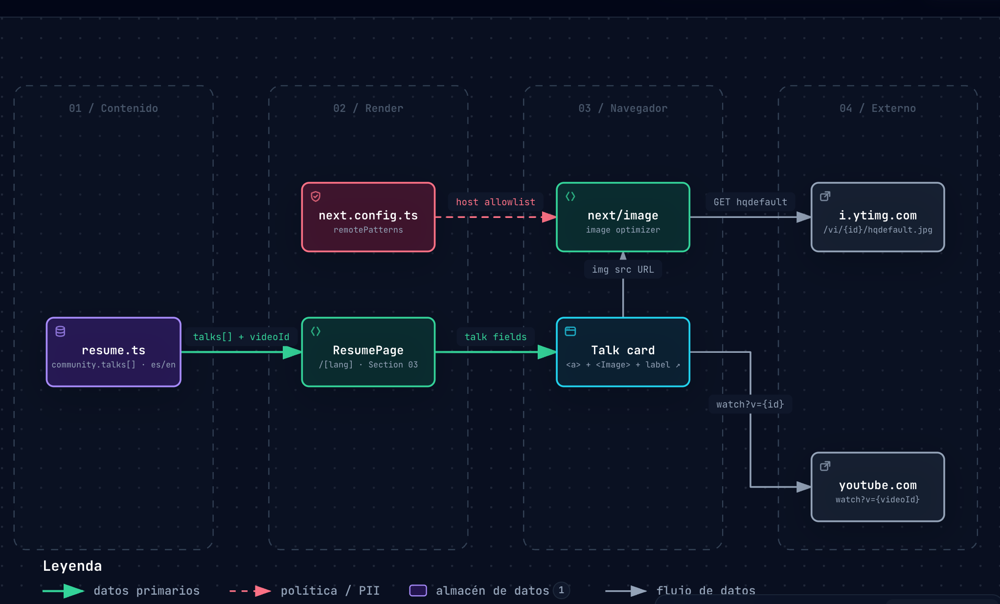
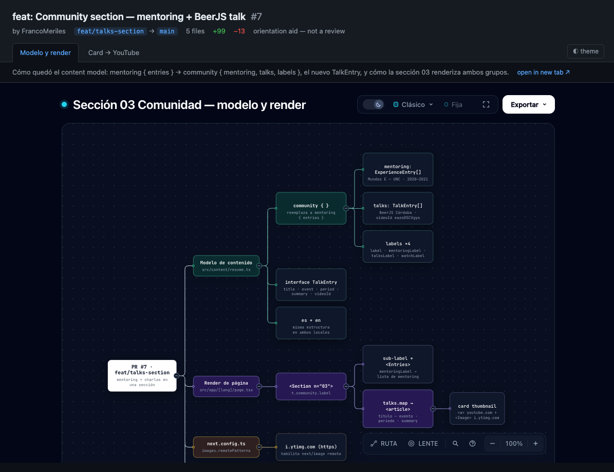

<h1 align="center">Explain this PR</h1>

<p align="center"><b>An agent skill that turns a pull request into an interactive walkthrough.</b><br>Validated Archify diagrams plus an optional crafted isometric Anatomy figure,<br>assembled into a standalone local HTML site.</p>

<p align="center">
  <a href="https://agentskills.io"></a>
  <a href="LICENSE"></a>
  <a href="#requirements"></a>
  <a href="#requirements"></a>
</p>

<p align="center">
  <a href="#install">Install</a> ·
  <a href="#usage">Usage</a> ·
  <a href="#what-it-makes">What it makes</a> ·
  <a href="#how-it-works">How it works</a> ·
  <a href="#requirements">Requirements</a> ·
  <a href="#limits">Limits</a>
</p>

<p align="center">
  
</p>

<p align="center"><sub>A real atlas view generated for a small feature PR — every node and flow cites source lines at the pinned commit.</sub></p>

---

Point your agent at a pull request and it builds a standalone site that orients a reviewer: what the change makes true, how the pieces fit, and where data and control actually flow. It is an **orientation aid, not a code review** — no findings, no approve/reject, just maps.

## Install

```sh
npx skills add FrancoMeriles/explain-this-pr -g
```

The walkthrough is rendered by two other skills — install them too:

```sh
npx skills add tt-a1i/archify@archify -g          # required: all diagrams
npx skills add wheresryan22/anatomy@anatomy -g    # optional: the isometric figure + browser captures
```

## Usage

```text
explain this pr: https://github.com/owner/repo/pull/123
```

or, standing in a checkout:

```text
explain this pr: this branch / PR #123
```

The agent gathers the diff and discussion, picks the views the change actually needs, generates each diagram against the real repository (evidence-linked back to source lines), and assembles everything into `.explain-this-pr/pr-<n>/index.html` inside the repo. Multiple atlases coexist — a `.explain-this-pr/index.html` landing page lists them all.

## What it makes

- **Diagram views matched to the diff** — sequence for API calls, lifecycle for state changes, erd for schemas, architecture/tree for structure, dataflow for pipelines, workflow for user-facing flows. Each one is a validated, explorable HTML page with dark/light themes and image/SVG export, authored by [Archify](https://skills.sh/tt-a1i/archify/archify) from repository evidence at the pinned commit.
- **An optional isometric figure** — a crafted physical machine whose mechanism *is* the PR's core idea (a ratchet for retry backoff, a sluice for rate limiting), built by [Anatomy](https://skills.sh/wheresryan22/anatomy/anatomy).
- **A shell** — `index.html` with the PR's title, author, branches, diff stats, and one tab per artifact. Everything is a local file; it opens straight from disk.

<p align="center">
  
</p>

## How it works

1. **Evidence** — `gh pr view`/`gh pr diff`, or plain `git` when `gh` is absent. The PR head is inspected in a detached `git worktree`, so your checkout is never touched. If the repo isn't cloned, the agent asks before cloning — persistent clone, or an ephemeral one that is deleted after the report is moved out.
2. **Sizing** — file/line counts decide how many views a PR earns; a small PR gets a compact aid, not an architecture document.
3. **Views** — diff signals map to Archify diagram types; every multi-subsystem PR gets an overview first.
4. **Generation** — each diagram is authored as Archify JSON with cited source ranges and passes Archify's `finalize` gates (schema validation, delivery, provenance check, real-browser check) before it lands.
5. **Figure** — opt-in per PR; sized *Figure* by default, because an honest isometric machine takes real time.
6. **Assembly** — `scripts/assemble.mjs` builds the tabbed `index.html` from a manifest and rebuilds the landing page. Artifacts are referenced whole, never edited after validation.
7. **Verification** — the shell is screenshot in headless Chrome; whatever couldn't be verified is reported as such.

## Requirements

| Need | Why |
|---|---|
| Node.js ≥ 20.10 | Archify CLI, `assemble.mjs`, Anatomy kit |
| [archify](https://skills.sh/tt-a1i/archify/archify) skill | The diagrams are the atlas |
| [anatomy](https://skills.sh/wheresryan22/anatomy/anatomy) skill | The optional figure; also `capture.mjs` for shell verification |
| `git` | Diff and evidence |
| `gh` | Preferred for PR metadata and comments; falls back to git or a pasted diff |
| Chrome/Chromium | Archify's `browser-check` gate and Anatomy's captures |

## Limits

- It orients; it does not review. No findings or verdicts.
- Diagrams show the **after** state (the PR head), not a diff animation.
- Artifacts are self-contained HTML — they can be copied anywhere, but the report folder travels as a unit (its links are relative).
- The figure is only as good as the metaphor; mechanical PRs (renames, docs) are told to skip it.

## Repository layout

```
SKILL.md               the skill — workflow, dependencies, boundaries
references/            pr-evidence · view-mapping · metaphor-design
assets/                shell-template.html · landing-template.html
scripts/assemble.mjs   manifest -> index.html, plus the landing page
```

## License

MIT — see [LICENSE](LICENSE).
